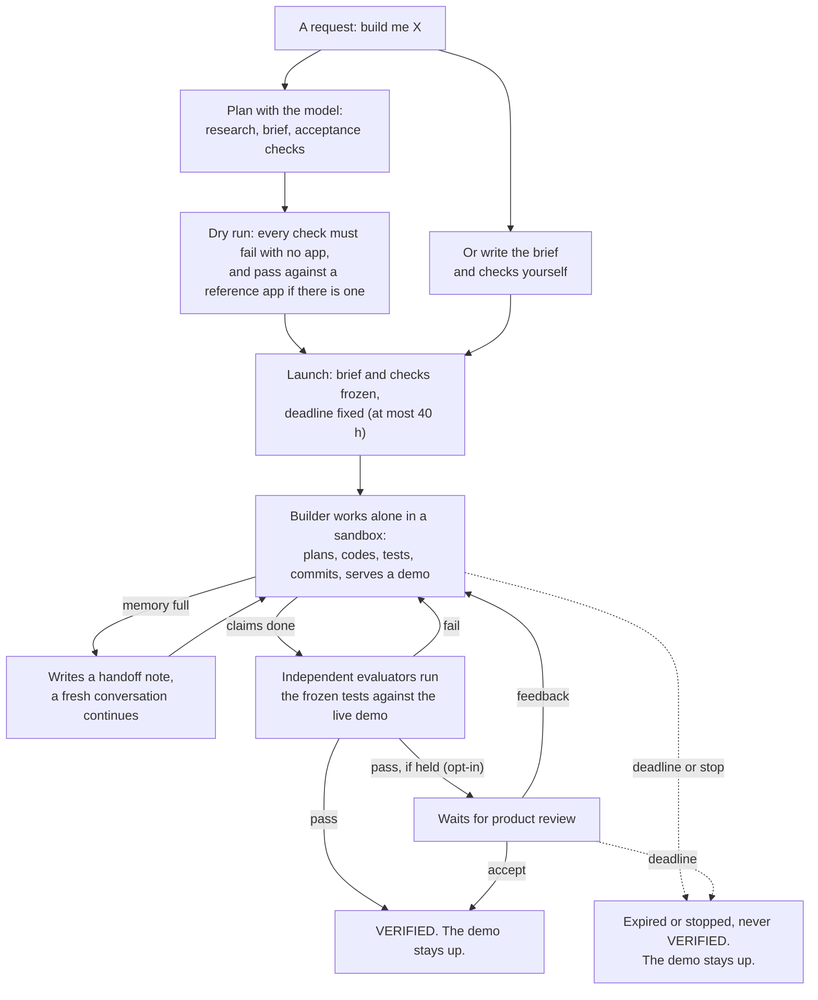

# dgx-autonomy

**Give an open-weights model a product brief and a computer that fits on a desk. Walk away. Come back to a working app.**

dgx-autonomy is an environment for letting a local model build software unattended for up to 40 hours. It runs on a single NVIDIA DGX Spark. No cloud model writes the code, nobody answers the builder's questions, and there's no per-token bill. The builder works inside a locked-down sandbox with a small set of tools. It isn't done when it *says* it's done. It's done when acceptance tests it can't touch say so.

**Status:** experimental. It has run on one machine. It is pinned to OpenHands 1.49.4 (`pyproject.toml`), and there is no CI: the tests run locally. The builder has internet access, and the boundary around it is host firewall rules (nftables) plus container hardening, not a VM.

## Why

Putting a frontier model in a loop is no longer news. Claude or GPT in a `while true`, pointed at a task, has been a thing for a while, and it works remarkably well. It also means paying API costs to build the thing, and often again to run the models inside it.

This project asks a different question: **how far can open-weights models on hardware you own get, if you're willing to trade speed for patience?**

A desk-sized box decodes at roughly 20 tokens a second, a fraction of what a data centre does. The bet is that it doesn't matter. If the model can keep going for 40, 60 or 80 hours, stay on track, recover from its own mistakes, and be held to an objective standard, then speed matters less than persistence.

That's also an argument for **sovereign AI**:

- **Your model.** The weights sit on your disk. Nobody can reprice, rate-limit or deprecate them.
- **Your hardware.** The builder and the model run on the same box. The running cost is electricity.
- **Your data.** The builder, its model, the planner and the checks all run on the machine. What the operator chooses to share can leave it, and during these runs I shared some: a Claude session followed the run feed, the Shoreline and Camp Yahtzee briefs and checks were written and dry-run on my Mac, and `review-request` bundles a run for a stronger model to review. The builder itself reaches the internet for packages, documentation and public APIs.

## What it has built

| Project | What it is | Result |
|---|---|---|
| [**Shoreline**](https://github.com/EduardKakosyan/shoreline) · [live](https://eduardkakosyan.github.io/shoreline/) | A mobile-first app for a day at the water: beach and fishing verdicts with reasons, today's tides, sea state, the moon and the forecast. It grew from a weather app over three runs. | 42 commits by the builder, 19/19 acceptance checks (78 tests). The Shoreline brief itself took about 8 hours of a 40-hour budget, then a round of product feedback. The run expired while held for review, so the controller never marked it VERIFIED. I accepted its final state afterwards; that is recorded only in the [operator log](docs/operator-log.md#2026-09-28-1230-utc-shoreline-expired-while-held-the-final-state-is-accepted-on-review). |
| [**Camp Yahtzee**](https://github.com/EduardKakosyan/yahtzee) · [live](https://eduardkakosyan.github.io/yahtzee/) | Official-rules Yahtzee for one iPhone passed around a camp table: 1–8 players, real or on-screen dice, game after game with a session tally, installable and offline. | 18 commits by the builder. Both completion claims passed 24/24 acceptance tests, with two rounds of product feedback. The builder had every check passing about 2 hours in. The operator log ends before its review did, so its acceptance is not recorded here. The live app also has one later commit I made by hand with CodeLayer. |

It also wrote the first version of **Keeper**, a self-hosted meeting memory (archive, search, REST API and an MCP server). Keeper has since replaced a SaaS notetaker for my team, and I've developed it further with Claude Code. Its code is private.

Each project repo carries its own loop record: the frozen brief and acceptance checks for every run, and every message the operator sent the builder.

## How it works



### 1. Agree on "done" before anything is built

A run starts from two things:

- **A brief.** What to build and for whom, written so that a builder working alone for 40 hours never needs to ask a question.
- **Acceptance checks.** Executable Playwright and pytest tests, plus criteria that only a human can judge.

There are two ways to write them.

**With the planner** (`dgx-autonomy plan`). The operator works with the same model that will build the app, in a sandbox like the builder's. Together they research the request (the planner can use `curl`) and draft the brief and checks. Then `/checks` **tests the tests**. Every check must *fail* when no app is running; a check that passes there checks nothing. If the planner also wrote a throwaway reference app, every check must *pass* against it; a check that fails there couldn't be satisfied by any app. The reference app is optional, and so is the dry run: `/launch` asks the operator to type `force` for a draft whose checks haven't passed one.

The reference app exists because that mistake once got through: a planner froze checks with a locator that matched two labels on any page, so no app could ever pass them (commit 908b46a).

**By hand** (`dgx-autonomy launch --brief DIR`). The operator supplies `brief.md` and `checks/` directly. There is no planner and no dry run. A brief with no checks is accepted too; its completion is then only the builder's claim. Shoreline and Camp Yahtzee were both launched this way. Their briefs and checks were written with a Claude session on my Mac, and the checks were dry-run there against a throwaway reference app.

At launch the brief and checks are **frozen** with a digest. The builder can read them but not write them, and the digest is checked again before every evaluation.

### 2. Build, alone

The builder is an [OpenHands](https://github.com/OpenHands/software-agent-sdk) agent. OpenHands supplies the think → act → observe loop. This project supplies everything around it.

| Tools the builder has | |
|---|---|
| terminal, file editor, task tracker | OpenHands built-ins. The builder installs packages, runs tests and drives its own headless browser. |
| `start_demo` | Serves the app. It's the only thing that keeps running after the builder stops. |
| `report_progress` | A line in the operator's notification feed. |
| `write_handoff` | The builder's structured note to its future self when a conversation is replaced. |
| `declare_blocked` | "No viable path is left." A fresh conversation must confirm it before the run ends. |
| `finish` | A **claim** that the work is done. Nothing more. |

The custom tools can only *ask*. Each one writes a request, the controller outside the sandbox validates it, and the answer comes back through a read-only directory.

### 3. "Done" is a claim

When the builder finishes, the controller:

1. **pins** the project in its own git store (not the builder's, whose hooks it doesn't trust);
2. makes sure the demo serves exactly that snapshot;
3. runs each frozen check in its own disposable, unprivileged evaluator container, against the live demo;
4. snapshots again. If anything changed mid-test, the result is inconclusive: nothing is sent to the builder, and the same claim is evaluated again.

If every required check passes, the run is **VERIFIED** (unless it is held for review; see below). Otherwise the builder receives each failure with the assertion's expected and received values, and keeps going.

A test runner that crashes, times out or gets killed is an infrastructure error: never a pass, and never blamed on the app. The report keeps four things apart: what the builder claimed, what the checks proved, what awaits human judgment, and any optional review by a stronger model.

### 4. Memory that outlives the context window

A 40-hour run can't fit in one conversation. The controller replaces the conversation when:

- its context is nearly full;
- it gets stuck repeating itself;
- it keeps erroring;
- three claims in a row fail.

Before the old conversation goes, it writes a **handoff**: a roadmap, decisions, approaches that failed, and next steps. The controller validates it. An item marked done has to cite evidence: a file that exists, or an evaluation that ran. The builder is not allowed to call anything "verified", because only the environment records that.

The fresh conversation starts from the frozen brief, that handoff (labelled as claims, not facts), what the environment actually verified, and any operator feedback. After a stuck or failing streak it's told to diagnose first and change approach. Shoreline's final run used six conversations.

### 5. Product review

Tests catch regressions, but they don't catch "the sun looks brown". Holding a run for review is opt-in: `launch --hold`, or `dgx-autonomy hold RUN_ID` while it runs. Without it, the first claim that passes every required check finishes the run. With it, a passing claim waits for the operator. The operator opens the live demo, then either accepts it (`accept`: the run is VERIFIED) or sends product feedback (`feedback`): what a user sees and should feel, never how to code it. The frozen checks still decide completion. Feedback raises the bar on top of them.

The deadline still applies while a run waits. A run that reaches it expires, and an expired run is never VERIFIED, even if its last claim passed every check; `accept` refuses it. That happened to Shoreline, so my acceptance of it is only in the operator log.

### 6. The boundary

- The builder runs as an unprivileged user with no Linux capabilities and no sudo.
- It sees only its workspace, the frozen brief and a read-only control directory. It has no Docker socket.
- It can reach the internet, but host firewall rules reject the machine itself, the LAN, the tailnet and other private address ranges.
- It holds no API keys and no payment details. Operating restrictions are boundaries, not obstacles to route around.
- The deadline is written once and enforced by its own watchdog thread.
- On stop, the controller kills every agent process (pausing the conversation alone was measured not to be enough). The demo stays up.
- The controller survives crashes and reboots. Each step records its intent before acting and checks what already exists before repeating anything.

## The local model

The builder is **Qwen3.8-Flash-Next**, a 125-billion-parameter open-weights model, running on a DGX Spark with 128 GB of unified memory. Three properties make a model that size practical on one box:

- **Mixture of experts.** Each token uses only about 6B of the 125B parameters. Generation speed on this hardware is limited by how much it reads from memory per token, so this is the main reason it's usable.
- **Hybrid attention.** Only 12 of its 48 layers keep a memory of every past token; the rest keep a fixed-size running state. At 256K tokens that memory takes about 3.2 GiB in llama.cpp's 8-bit cache, or about 6.5 GB in SGLang's bf16 cache: a quarter of what it would be if every layer kept one.
- **Sparse attention.** Each new token attends only to the most relevant blocks of the context, not to all of it.

For the Shoreline and Camp Yahtzee runs it was served by [SGLang](https://github.com/sgl-project/sglang) from a 4-bit NVFP4 checkpoint (`qwen3.8-flash-next-sglang` in `config/models.yaml`; the file's default is still the llama.cpp build). SGLang has real sparse-attention kernels and uses the model's **multi-token prediction** heads for speculative decoding: a small head drafts 4 tokens, and the full model checks them in one pass. The first backend was llama.cpp, which computes the sparse attention densely under a mask. It slowed down as the context filled:

| Context in use | llama.cpp (Q3 GGUF) | SGLang (NVFP4 + MTP) |
|---|---|---|
| near empty | ~25 tok/s | ~21–25 tok/s |
| 100–125K | ~13 tok/s | ~21–25 tok/s |
| 150–175K | ~10 tok/s | ~21 tok/s |
| 200K+ | ~8 tok/s | — |
| prompt reading (205K tokens) | 387 tok/s | 1,940 tok/s |

The SGLang figures are medians from a live build, sampled up to 180K tokens of context. The prompt-reading row comes from qualification. The builder spends most of its time above 100K tokens, so SGLang roughly doubled its effective speed.

I use a model only after **qualification** on the target machine, with the whole workload running alongside it (the controller doesn't enforce this):

- five tool-calling probes;
- a prompt filling 75% of the context, with a word to recall from its start;
- a real build that must end VERIFIED;
- memory and swap sampled throughout.

A smaller fallback, Qwen3.6-35B-A3B (about 17 GB), is also qualified and decodes at about 52 tok/s.

## The human (and Claude) in the loop

This isn't about replacing frontier models. They're the best supervisors available. During these runs a Claude session followed the DGX's notification feed (launches, progress, claims, evaluations, handoffs). It flagged when something needed attention, reviewed the live apps alongside the operator, and helped write product feedback and new feature requests. The local model wrote every line of each build. The app repos also carry the operator's README and loop record, and Camp Yahtzee was extended by hand afterwards (one commit, made with CodeLayer). Frontier models manage; the open model builds, around the clock.

## What we learned

- **Verification is the whole game.** Local models claim success early and confidently. A test they can't edit, run from outside the app, turns "I think it works" into evidence.
- **Test the tests.** Checks that pass with no app, and checks no app can pass, are both easy to write. One of the second kind got past careful planning and was frozen into a run. A dry run against a reference app, when the planner writes one, now catches it.
- **Persistence beats speed.** The builder diagnosed its own bugs across conversations. It built a pixel detector to hunt down a visual smudge from feedback, and a 7,776-roll dice oracle to prove its scoring.
- **Handoffs need enforcement.** One builder ignored a handoff request for 43 minutes while its context filled. A reminder after every three unrelated actions got a handoff within a minute.
- **Bound everything.** An uncapped response ran 10,000+ tokens of thinking for 20 minutes. Response length and request timeout are now set per model, and so is a thinking budget where the server has one (llama.cpp does; SGLang doesn't).
- **Model servers differ in ways that matter.** SGLang refuses a request whose prompt plus maximum output exceeds the context; llama.cpp never did. The rollover threshold now leaves room for a full response.
- **Small frictions compound.** One run hit 21 refused terminal commands in 6 hours, because OpenHands rejects multi-line input such as a heredoc followed by its command. A small patch runs such input as one block.
- **Tests aren't taste.** Every product review found something the checks couldn't see, like a keypad whose badges hid a pip so a 4 read as a 3. The review hold exists for this.
- **The operator needs a pager.** Three held runs waited hours for review because the monitoring session had ended. Notifications need to outlive the laptop.

## Running it yourself

It has run on one DGX Spark, and some defaults name that machine (see [Adapting it to another machine](#adapting-it-to-another-machine)).

### Requirements

- **An NVIDIA DGX Spark (GB10).** The llama.cpp inference image is compiled for `sm_121a`, and its build fails without it. The SGLang image is a pinned arm64 build. Another GPU needs a rebuilt llama.cpp image (`containers/inference.Dockerfile`) and a matching SGLang image.
- **Memory** for the model and the workload beside it. The controller loads a model only when its weights plus 8 GiB are available. With SGLang serving Qwen3.8-Flash-Next, about 9.3 GiB stayed available during qualification with the whole workload running.
- **Disk** for the weights (below). SGLang also writes a 47.7 GiB N-gram table file under `/var/lib/dgx-autonomy/inference/ple` each time it starts.
- **Software on the box:** Docker with the NVIDIA container runtime, nftables, systemd, and [uv](https://docs.astral.sh/uv/) at `~/.local/bin/uv` with Python 3.12 or later. The laptop needs `ssh` and `rsync`, and uv to run the tests.
- **sudo**, for `host/install.sh`, and for Docker unless the operator account is in the `docker` group.
- **systemd lingering** for the operator account, so that `release --after RUN_ID --detach` keeps waiting with nobody logged in.

| Model | Download | In memory | Fits on |
|---|---|---|---|
| Qwen3.8-Flash-Next (NVFP4, SGLang) | ~126 GiB, plus the 47.7 GiB table file | ~101 GiB | a 128 GB DGX Spark, with no other large model loaded |
| Qwen3.8-Flash-Next (Q3 GGUF, llama.cpp) | ~84 GiB | ~91 GiB | a 128 GB machine |
| Qwen3.6-35B-A3B (Q3 GGUF, llama.cpp) | ~17 GB | ~18 GiB | much smaller machines |

### Quickstart

The CLI runs on the box: SSH in, then run `dgx-autonomy` there. These steps use the SGLang model, which served every run since 2026-09-25. The default in `config/models.yaml` is still the llama.cpp build, so pass `--model`. The [operator manual](docs/operator-manual.md#operator-setup-once-privileged) has the full commands for steps 1–4.

1. **Deploy**, from the laptop: `DGX_HOST=<ssh-host> scripts/deploy.sh`. It copies the repo to `~/dgx-autonomy` on the box, runs `uv sync` there, links the CLI into `~/.local/bin` and writes `containers/.env`.
2. **Install the host pieces**, on the box, after reading every file in `host/`: `sudo ~/dgx-autonomy/host/install.sh`. This is required: the controller creates no sandbox until the egress rules are loaded. It installs the firewall rules, the reservation helper, the busy notice and a sudoers entry.
3. **Download the model** and pull the SGLang image. The model files must be readable by the inference container's unprivileged user.
4. **Build the images and start the controller:**

   ```bash
   cd ~/dgx-autonomy/containers
   sudo docker compose --profile images build
   sudo docker compose up -d controller
   ```

5. **Reserve the GPU**, only if another model service shares it (the reference box has one): `dgx-autonomy reserve --no-inference`. Qualification and launches start the model themselves.
6. **Qualify the model:** `dgx-autonomy qualify qwen3.8-flash-next-sglang`.
7. **Start a run**, one of two ways:
   - `dgx-autonomy plan --model qwen3.8-flash-next-sglang`, agree on a draft, run `/checks`, then `/launch 40`. To review before it finishes, also run `dgx-autonomy hold RUN_ID`.
   - `dgx-autonomy launch --brief DIR --model qwen3.8-flash-next-sglang --hold`, where `DIR` holds `brief.md` and `checks/`.
8. **Follow it:** `dgx-autonomy notify --follow`.
9. **Open the demo:** `dgx-autonomy tunnel RUN_ID` prints an `ssh -N -L …` command. Run that on the laptop, then open the URL it names.
10. **Review a held run:** `dgx-autonomy feedback RUN_ID FILE`, or `dgx-autonomy accept RUN_ID`.
11. **Read the result:** `dgx-autonomy report RUN_ID`.
12. **Give the GPU back**, if you reserved it: `dgx-autonomy release --after RUN_ID --detach` waits for the run to end, then releases.

To run the tests (on the laptop or the box):

```bash
uv sync
uv run pytest -m "not dgx"             # about 390 tests; no GPU, Docker or model needed
```

### What a run produces

`dgx-autonomy report RUN_ID` prints a run's evidence, kept apart by kind: the builder's claims, each check's latest result and history, the criteria awaiting human judgment, every evaluation, and any stronger-model reviews. For a published sample, Shoreline's repo keeps the record of [its run](https://github.com/EduardKakosyan/shoreline/tree/main/loop/runs/3-shoreline): the frozen brief, the acceptance checks and every message the operator sent the builder.

### Adapting it to another machine

These files hold values from the reference machine:

| Where | What |
|---|---|
| `src/dgx_autonomy/cli.py` (`DEFAULT_SSH_HOST`) | the default SSH host that `tunnel` prints; `--ssh-host` or `DGX_AUTONOMY_SSH_HOST` overrides it |
| `scripts/deploy.sh` (top of the file) | the default SSH host, destination and models directory (`DGX_HOST`, `DGX_DEST` and `DGX_AUTONOMY_MODELS` override them), and the operator account in the steps it prints |
| `src/dgx_autonomy/config.py` (`DEFAULT_MODELS_DIR`) and `containers/compose.yaml` (`DGX_AUTONOMY_MODELS`) | the default models directory, in the operator account's home; `containers/.env` overrides it |
| `host/sudoers-autonomy` | the operator account that may run the reservation helper |
| `host/install.sh` (its last check) | the same account |
| `src/dgx_autonomy/reservation.py` (`SERVICE`) | the systemd unit of the other model service that `reserve` displaces |
| `config/models.yaml` | models, paths, context sizes and limits. The controller reads the copy in its image, so rebuild the image after editing it |

`host/install.sh` installs the reservation helper and busy notice together with the egress policy, which is not optional. On a machine with no other model service, install them anyway and never run `reserve`.

The firewall rules (`host/nftables-autonomy.nft`) need no edits. They reject every address of the machine itself, all RFC 1918 ranges, CGNAT (which includes Tailscale), IPv6 unique-local and link-local addresses, and multicast, and they match the two Docker bridges by fixed name. They don't cover a LAN reached over public IPv6 addresses.

The [operator manual](docs/operator-manual.md) covers setup, every command, and each mechanism in detail.

## Repository map

| Path | What's there |
|---|---|
| `src/dgx_autonomy/controller.py` | The controller: run lifecycle, evaluations, rollovers, recovery, stop |
| `src/dgx_autonomy/openhands_adapter.py` | How conversations are created and observed through the OpenHands Agent Server |
| `src/dgx_autonomy/{demo_tool,handoff_tool,terminal_grouping}.py` | The builder's custom tools and the terminal patch |
| `src/dgx_autonomy/{frozen,snapshot,evaluation}.py` | Frozen agreements, snapshots, and running the checks |
| `src/dgx_autonomy/{checkpoints,planning}.py` | Handoffs and recovery context; the planner |
| `src/dgx_autonomy/{inference,qualify}.py` | Serving models (llama.cpp and SGLang) and qualifying them |
| `containers/` | The agent, evaluator, inference and controller images, and the in-sandbox supervisor |
| `host/` | Host firewall rules, the reservation helper and the busy notice |
| `docs/operator-manual.md` | The full manual for the reference deployment |
| `docs/operator-log.md` | The supervising session's running log, 2026-09-22 to 2026-09-29: launches, reviews, failures and fixes |
| `docs/design/` | The original plan (research, PRD, technical design, structure outline) and the SGLang investigation, kept as a record |
